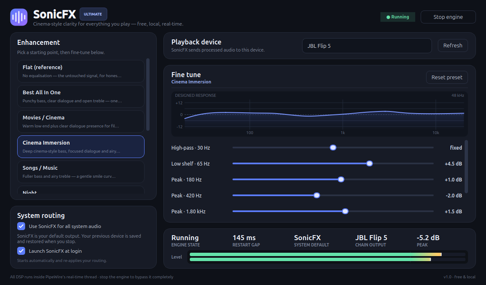
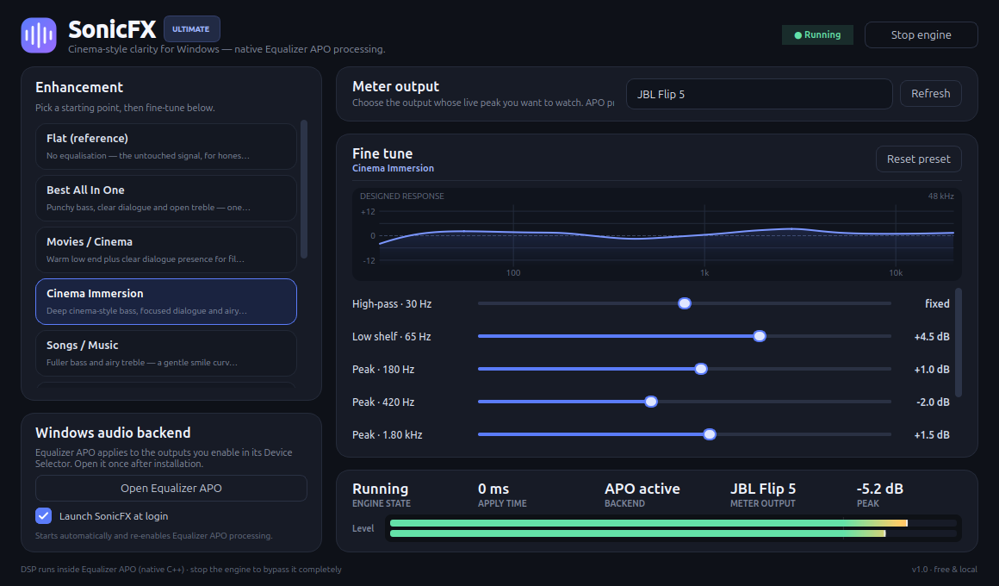

# SonicFX Ultimate

A free, local, open-source **system-wide audio enhancer for Linux and Windows**.
It applies real-time parametric EQ presets (all-in-one, cinema immersion, music,
night, headphones, voice, gaming, bass) to live audio from browsers, VLC, games
and any desktop app.

* **Linux** uses PipeWire's native C `filter-chain` DSP. It can optionally become
  your default output so everything is processed, with the previous default
  saved and restored.
* **Windows 10/11** uses the free, open-source **Equalizer APO** native C++ APO
  as the real-time DSP backend. SonicFX is the controller: it writes a safe
  Equalizer APO include and never puts Python in the audio path.
* No subscriptions, accounts, ads, paid APIs or cloud processing.
* Explicit and honest limits — see `docs/feature-limitations.md`. It does not
  claim Dolby/Dolby Atmos compatibility and does not fake unavailable features.
* **Cinema Immersion** is available on both platforms: a stereo tonal curve with
  deep bass, focused dialogue and airy highs. It is not object audio and is not
  a Dolby Cinema/Atmos implementation.
* **Cinema Spatial** is the Linux native virtualiser: a virtual 7.1.4-style
  HRTF ring for headphones and transaural width/room processing for stereo
  speakers. It is an upmix effect, not Dolby Atmos or object audio. See
  [`docs/cinema-spatial.md`](docs/cinema-spatial.md).



## Install

### Windows 10/11 x64

Requires **8 GB RAM**, **4 GB free disk**, Administrator once, and a reboot after
the Equalizer APO driver install.

```powershell
# Elevated PowerShell, from a checkout:
Set-ExecutionPolicy -Scope Process Bypass
.\scripts\install-windows.ps1
```

Over SSH as an administrator, without launching a GUI in the remote session:

```powershell
$url = 'https://raw.githubusercontent.com/harshasamala9-lab/sonicfx-ultimate/main/scripts/install-windows.ps1'
$dst = "$env:TEMP\sonicfx-install.ps1"
Invoke-WebRequest $url -OutFile $dst -UseBasicParsing
powershell -NoProfile -ExecutionPolicy Bypass -File $dst -NoLaunch
```

The installer checks the RAM/disk target, installs Python 3.12 only if needed,
SHA-256 verifies and installs Equalizer APO 1.4.2, creates an isolated venv,
grants write access to Equalizer APO's config folder, and adds shortcuts. It
does **not** change the Windows default output. After the first launch, click
**Open Equalizer APO** and tick your speakers/headphones once.



Full details, troubleshooting and the physical validation checklist:
[`docs/windows.md`](docs/windows.md).

### Linux (Ubuntu / Linux Mint / Debian)

From a checkout:

```bash
bash scripts/install-linux.sh
```

Remote install over SSH:

```bash
ssh user@host 'bash -s' < scripts/install-linux.sh
```

The installer checks **8 GB RAM / 4 GB free disk**, installs the minimal
PipeWire/Qt runtime packages plus `libmysofa1` (MIT KEMAR HRTF) and
`swh-plugins` (look-ahead limiter), creates `.venv`, installs the app and adds
`~/.local/bin/sonicfx` plus a desktop entry. It does not install the large
optional LADSPA/LV2 plugin set and does not touch the default sink.

Low-resource details and flags: [`docs/install-low-spec.md`](docs/install-low-spec.md).

## Run it

### Linux

```bash
~/.local/bin/sonicfx
```

On first launch the window starts the engine, selects the current default
hardware output and — because this profile opted in — makes **SonicFX the
default output**. Apps keep playing normally; their audio is routed through
SonicFX and then to the chosen device. The **Songs / Music** preset is the first
choice, with **Best All In One** and **Cinema Immersion** one click away.

* Toggle **Use SonicFX for all system audio** at any time.
* **Stop engine** (or closing the window) restores the previous default device
  and stops the chain. If the previous device has disconnected, the selected
  output is used instead.
* **Launch SonicFX at login** is enabled on first run so default routing
  survives a reboot; untick it to opt out.
* DSP edits regenerate the chain and briefly restart it (debounced; ~150–260 ms).
  This is a PipeWire filter-chain limitation and is shown honestly in the UI.
* Everything is local. The app does not require an internet connection.

The default-routing preference and the previous device are stored in
`~/.local/state/sonicfx/routing.json`; window and audio preferences live in
`~/.config/SonicFX/`. See `docs/stage4-gui-routing.md` for the live verification
and safety rules.

### Windows

Launch **SonicFX Ultimate** from the Start Menu, desktop shortcut, or the
Startup entry. The app starts the Equalizer APO backend when it finds a valid
install. The **Meter output** selector only chooses which endpoint's peak level
is shown; it does not route audio. Equalizer APO applies to the endpoints ticked
in its own Device Selector — the app never switches the Windows default device.

DSP edits are written atomically to Equalizer APO's `config\sonicfx.txt`. The
user's own `config.txt` is preserved, and a one-time
`config.txt.sonicfx-backup` is made before the `Include: sonicfx.txt` line is
added. **Stop** removes the include, so the user's EQ is untouched.

## Windows validation status

The Windows config renderer, include safety, backups, disable path, autostart
helper and controller have automated tests. **Real Equalizer APO processing and
WASAPI loopback metering have not yet been validated on physical Windows audio
hardware in this repository's CI.** Use the checklist in `docs/windows.md` on a
real Windows 10/11 machine before calling the Windows build release-proven.

## Status

| Stage | Scope | State |
|---|---|---|
| 1 | Environment audit, dependency scripts | ✅ done (`docs/stage1-environment-audit.md`) |
| 2 | Offline DSP foundations (design plane) | ✅ done — 71 tests (`docs/stage2-dsp-results.md`) |
| 3 | Real PipeWire filter-chain path | ✅ verified — real DSP measured, 144.6 ms restart (`docs/stage3-results.md`) |
| 4 | PySide6 GUI + explicit routing + default sink | ✅ working live (`docs/stage4-gui-routing.md`); live peak meter ✅, LUFS meter, reconciler and soak still open |
| 5–7 | Spatial/dynamics depth, profiles/diagnostics, packaging | pending |
| Windows | Equalizer APO backend + installer + shared presets | ✅ code/tests; ⏳ physical Windows audio validation pending |

## Quick start (developer)

Linux:

```bash
# 1) System packages (once, needs sudo — safe & side-effect free beyond apt)
bash scripts/install-deps.sh

# 2) Python environment (no sudo)
bash scripts/setup-venv.sh

# 3) Verify the environment produces the audit report
.venv/bin/python -m sonicfx.diagnostics.environment
```

Windows development uses the same package. Create a venv and run
`pip install -e ".[dev]"`; the Windows backend loads only on `sys.platform ==
"win32"`, and its config tests run on any OS.

## Free 4K movie companion (Linux)

A separate, fully free playback stack for watching 4K movies and listening to
music on the same laptop:

```bash
sudo scripts/install-media-4k.sh
```

It installs Intel iHD VA-API hardware decoding, mpv + Celluloid, `yt-dlp` for
YouTube/URL playback, GStreamer VA-API plugins and Firefox VA-API preferences.
Details, verification commands and troubleshooting: `docs/media-4k-setup.md`.
It does not change your default audio devices or SonicFX routing.

## Repository layout

```
src/sonicfx/
  app.py          # Qt bootstrap + platform backend dispatch + error funnel
  autostart.py    # XDG login autostart entry (Linux)
  ui/             # PySide6 window, theme, widgets, Linux controller
  audio/          # Linux EngineAPI facade + explicit output routing
  pipewire/       # chain generator, supervised daemon, wiring, default-sink routing
  windows/        # Equalizer APO backend, Windows controller, WASAPI meter, autostart
  dsp/            # offline design math (coefficients, response curves, IRs)
  profiles/       # built-in enhancement presets + custom profiles
  database/       # SQLite persistence
  diagnostics/    # environment audit, logs, recovery
docs/             # architecture, stage results, limitations, Windows guide, licenses
tests/            # pytest suites (live PipeWire suite opt-in)
scripts/          # install / setup / probe / preview / packaging
```

## License

MIT for SonicFX itself. Runtime dependencies each carry their own licenses —
notably Equalizer APO (GPL-2.0), which is installed separately, and PySide6
(LGPL-3.0). See `docs/licenses.md`.
